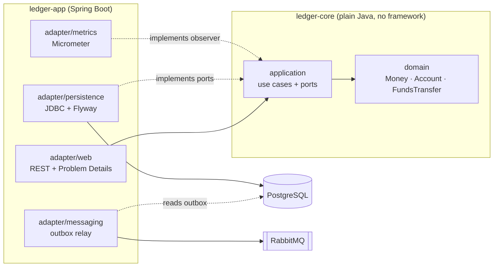

# ledger-performance-lab

[](https://github.com/Rt-00/ledger-performance-lab/actions/workflows/ci.yml)

A double-entry ledger (accounts, deposits, transfers, statements) in **Java 21 + Spring Boot 4**,
built with **DDD and TDD**, and used as a lab to answer performance questions with **measured
numbers** instead of opinions.

> 🇧🇷 Resumo em português no fim da página.

**Stack:** Java 21 · Spring Boot 4.2 · PostgreSQL 18 · Flyway · RabbitMQ 4 · JDBC (`JdbcClient`) ·
JUnit 5 · AssertJ · Testcontainers · ArchUnit · JaCoCo · k6 · Docker Compose

## What the lab found

| Experiment | Result |
|---|---|
| [Pessimistic vs optimistic locking](docs/experiments/01-locking-strategies.md) | With a hot account, optimistic locking made ~1.9 retries per transfer, had a 2.4x higher p99 and **still failed 26% of requests**. Pessimistic: 0 failures. |
| [OFFSET vs keyset pagination](docs/experiments/02-pagination.md) | On a 1M-entry statement, OFFSET reached 252 ms on the last page; keyset stayed at **~0.1 ms at every depth**, after fixing a planner trap that made the last page 12,000x more expensive. |
| [Connection pool size](docs/experiments/03-connection-pool-size.md) | 8 connections served **45% more requests** than 64, with a 2.5x lower p99. |
| [Virtual threads](docs/experiments/04-virtual-threads.md) | No gain: the database pool, not threads, was the bottleneck (Little's law shows it). |

### Bugs the tests caught
- **Deadlock in optimistic mode**: `A→B` and `B→A` updated rows in opposite orders. Found by a
  concurrency test against real PostgreSQL, fixed by writing accounts in id order.
- **Half-applied transfer in memory**: a credit to a blocked account failed *after* the debit.
  The domain now validates the credit side before mutating anything.
- **Last-page planner trap**: the primary key on `id` let PostgreSQL pick a plan that scanned 136k
  rows to return 50. Fixed by making the primary key `(account_id, id)`.
- **Migration that hung forever**: `CREATE INDEX CONCURRENTLY` waited on Flyway's own lock
  transaction; diagnosed with `pg_stat_activity`.

## Architecture



- **Hexagonal, enforced by ArchUnit**: the domain depends only on the JDK, the application only
  on the domain, and adapters never depend on each other ([ADR 0001](docs/adr/0001-hexagonal-core-without-framework.md)).
- **Double entry**: every transfer writes one DEBIT and one CREDIT entry. Deposits come from a
  settlement account, so **all balances of a currency always sum to zero**.
- **Exactly-once per `Idempotency-Key`**: replays return the original transfer (`200` +
  `Idempotent-Replayed: true`), a different payload with the same key is `409`, and two
  concurrent requests with the same key move money once (unique constraint + replay).
- **Locking as configuration**: `PESSIMISTIC` (ordered `SELECT ... FOR NO KEY UPDATE`) or
  `OPTIMISTIC` (version column + retry with exponential backoff and jitter)
  ([ADR 0002](docs/adr/0002-jdbc-instead-of-jpa-on-the-hot-path.md)).
- **Money as `long` minor units** with exact overflow checks; amounts cross the API as decimal
  strings ([ADR 0003](docs/adr/0003-money-as-long-minor-units.md)).
- **Transactional outbox** to RabbitMQ: `FOR UPDATE SKIP LOCKED`, publisher confirms,
  at-least-once with a dedup id ([ADR 0004](docs/adr/0004-transactional-outbox.md)).

## Testing strategy

| Layer | How | Example |
|---|---|---|
| Domain | Pure unit tests, written first | `FundsTransferTest`: a failed credit leaves the source untouched |
| Use cases | In-memory fakes **with rollback semantics** | `TransferFundsTest`: concurrent duplicate key resolved as a replay |
| Adapters | Testcontainers (PostgreSQL 18, RabbitMQ 4) | `OutboxRelayTest`: 4 relays in parallel never publish an event twice |
| Concurrency | 16 threads x 100 random transfers, then **audit the books** | `LedgerConcurrencyTest`: each balance = sum of its entries; each currency sums to 0 |
| API | `MockMvcTester` end to end | `LedgerApiTest`: replay, conflict, 422 problem details |
| Architecture | ArchUnit | `CoreArchitectureTest`, `AdapterArchitectureTest` |
| Database plans | `EXPLAIN` asserted in a test | `StatementIndexTest` keeps the pagination trap from coming back |

`./gradlew check` fails the build below **80% line coverage** per module (currently about 95% in
core and 99% in app).

## Running it

```bash
./gradlew check                          # all tests (needs Docker for Testcontainers)
./gradlew :ledger-app:bootJar
docker compose --profile app up -d --build

curl -s -X POST localhost:8080/accounts -H 'Content-Type: application/json' -d '{"currency":"BRL"}'
curl -s -X POST localhost:8080/accounts/<id>/deposits -H 'Idempotency-Key: dep-1' \
     -H 'Content-Type: application/json' -d '{"amount":"100.00"}'
curl -s -X POST localhost:8080/transfers -H 'Idempotency-Key: t-1' -H 'Content-Type: application/json' \
     -d '{"sourceAccountId":"<id>","targetAccountId":"<other>","amount":"25.50","currency":"BRL"}'
curl -s 'localhost:8080/accounts/<id>/statement?limit=20'
curl -s localhost:8080/actuator/prometheus | grep ledger_
```

Reproducing the experiments: `load-tests/experiments.sh` (load tests, about 25 min) and
`load-tests/pagination/` (seed + `EXPLAIN` comparison). Setup and caveats are in
[docs/experiments](docs/experiments/README.md).

## Decision records
- [0001 Framework-free core with ports and adapters](docs/adr/0001-hexagonal-core-without-framework.md)
- [0002 JDBC instead of JPA on the hot path](docs/adr/0002-jdbc-instead-of-jpa-on-the-hot-path.md)
- [0003 Money as long minor units](docs/adr/0003-money-as-long-minor-units.md)
- [0004 Transactional outbox](docs/adr/0004-transactional-outbox.md)

---

## 🇧🇷 Resumo

Ledger de partidas dobradas em Java 21 + Spring Boot 4, com DDD, TDD e arquitetura hexagonal.
Também é um laboratório onde comparo, com números medidos, lock pessimista vs. otimista,
paginação OFFSET vs. keyset, tamanho de pool de conexões e virtual threads. Os testes de
concorrência rodam contra PostgreSQL real e auditam a contabilidade depois de cada execução.
Eles encontraram um deadlock, uma transferência aplicada pela metade e uma armadilha do
planner do PostgreSQL, todos documentados acima.
